# edu_robot_api

A Python API for educational robotics. Robots, sensors and actuators are
represented as objects, with a consistent interface for reading measurements
and issuing control commands.

RoboWorkbench uses this API for independent virtual learning robots. Their
properties are defined by the selected model and learning environment.

## Installation

Local use requires Python 3.11 or later. After downloading this repository,
run the following command from its root directory:

```sh
python -m pip install ./wheels/edu_robot_api-0.6.0-py3-none-any.whl
```

Import the robot class in Python with:

```python
from edu_robot_api import Robot
```

Installing the library makes its classes available. It does not create a robot
or start a simulation. A standalone Python application must supply the robot
object and its execution environment.

Source code is in [core/](core/), and the installation package is in
[wheels/](wheels/). [SHA256.json](SHA256.json) contains file checksums.

## Programming in RoboWorkbench

No local installation is needed in the web app. Each editor's robot is already
available as `rob` when its program starts. The program does not need to specify
a robot name or establish a connection. Each editor controls its own robot.

This example requires a front distance sensor. It moves forward while the
measured distance is at least 25 cm and stops otherwise:

```python
import time


def program(robot):
    front_sensor = robot.sensors()["distance_front"]
    while True:
        distance = front_sensor.read()
        if distance is None or distance < 25:
            robot.stop()
        else:
            robot.forward(30)
        time.sleep(0.03)


program(rob)
```

The web app stops the robot and releases its connection when the program ends,
fails, or is stopped or reset. User programs do not need `try/finally` for this
cleanup. Sensor access and programming mistakes can still raise exceptions.

With two robots, each has its own source code in its own editor. Both programs
run concurrently; `time.sleep()` in one does not block the other. In each program,
`rob` refers to that program's robot. A program cannot take control of another
editor's robot.

## Sensors and actuators

`rob.sensors()` and `rob.actuators()` return dictionaries of component objects.
Available components depend on the selected model. A class describes a
component's capabilities; its name describes its role in a particular robot.

```python
left = rob.sensors()["line_left"]
right = rob.sensors()["line_right"]
readings = rob.read_sensors([left, right])
print(readings[left], readings[right])
```

`sensor.read()` reads an individual sensor. `rob.read_sensors()` captures a
snapshot. Values can be accessed by sensor object, captured name or position
in the selection. `None` indicates an unavailable measurement. An absent sensor
or an unsupported capability is a different situation and can raise an exception.

## Movement and units

| Call | Effect |
| --- | --- |
| `rob.forward(30)` | Move forward at 30 percent motor power |
| `rob.backward(30)` | Move backward at 30 percent motor power |
| `rob.drive(30, 10)` | Drive with positive steering to the right |
| `rob.stop()` | Stop the motors |
| `rob.set_speed(40)` | Set the default motor power for subsequent commands |

Distances are expressed in centimeters, angles in degrees and motor power as a
percentage. Motor power is not a guaranteed speed. Motion and measurements
depend on the model, world and environmental conditions.

## API structure

`Robot` owns sensor and actuator objects and delegates operations to a `Backend`.
This is a Python `Protocol`: a compatible implementation provides the method
`call(operation, *args)`. `FunctionBackend` satisfies this contract through a
mapping of operation names to Python functions.



The filled diamond denotes composition; the hollow triangle denotes inheritance.
The dashed connection from `FunctionBackend` to `Backend` indicates structural
implementation of the protocol. The library includes type annotations and a
`py.typed` marker for type-checking tools.

## License

The library is licensed under [Apache-2.0](LICENSES/core-Apache-2.0.txt).
